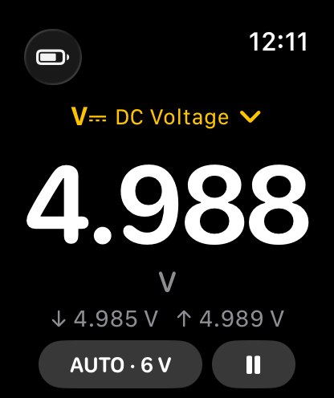
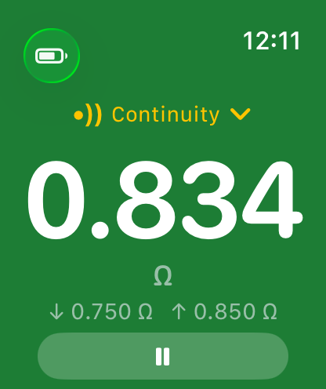
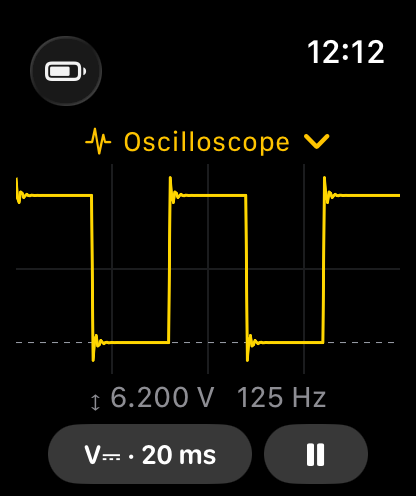
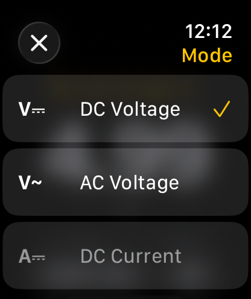

# pokit-watch

Use a [Pokit](https://www.pokitinnovations.com/) multimeter on the Apple Watch directly, without a phone.

The watch app, called **Wristmeter**, talks to a **Pokit Meter** or **Pokit Pro** over Bluetooth LE
and shows the reading on your wrist. The iPhone is only needed to install the app.

> Unofficial project, not affiliated with or endorsed by Pokit Innovations. "Pokit" is their
> trademark and is used here only to say which meters the app works with. Measuring mains or other dangerous
> voltages is at your own risk; the watch is a display, not a safety device.

  
  
  
  

Screenshots are rendered by CI in the watch simulator, using the app's built-in demo meter.

## What it does

- Finds Pokit devices, remembers the one you picked and **reconnects on its own** when you open
  the app with the meter switched on and in range.
- Connected **only while the app is on screen**: leaving it stops the measurement and drops the
  link, so the meter is not kept busy (or blocked for other apps) when nobody is looking.
- **Complications** for the watch face and the Smart Stack, so the app is one tap away:
  one that just opens it, and quick starts that open it straight in DC voltage or continuity.
- Multimeter modes: DC/AC voltage, DC/AC current, resistance, continuity, diode, temperature,
  plus capacitance and external temperature on the Pokit Pro.
- Auto-range or a fixed range; the display keeps the decimal point steady per range, like a
  bench meter (`12.3 mV`, `4.987 V`, `1.234 kΩ`).
- **Continuity on the wrist**: haptic tap and a green screen while there is continuity
  (the Pokit itself has no beeper).
- Hold (tap the value, or press the button on a Pokit Pro), running min/max.
- **Oscilloscope**: DC/AC voltage and current over 1 ms to 1 s, free-running or triggered on
  an edge, with peak-to-peak and frequency. The range follows the signal on its own.
- **Data logger**: start a recording on the Pokit (voltage, current or temperature, every
  1 s to 1 h), leave, and come back later to stop it and look at the result. The Pokit
  records on its own; the watch does not have to stay connected.
- Battery state, firmware and serial number, flash the LED (Meter), torch (Pro).
- English and German.

While the app is open a watchdog looks after the connection: if readings stop, the app first
asks the meter again and, if the link is really dead, reconnects from scratch.

## Using it

1. Switch the Pokit on and open **Wristmeter** on the watch.
2. Tap your meter in the list. From then on the app connects to it automatically.
3. Tap the mode line at the top to change the mode, the range button to change the range,
   the value (or the pause button) to hold. The battery icon opens the device page.
4. The oscilloscope and the data logger are at the end of the mode list. In the oscilloscope,
   tap the waveform to hold it and the left button for signal, range, time span and trigger.

If something does not work, the device page (battery icon) has a *Diagnostics* entry at the
bottom: a short record of what the app sent and what the meter answered. A screenshot of it
says more than a description.

Getting to it quickly:

- **Watch face:** touch and hold the face, *Edit*, swipe to *Complications*, tap a slot and
  pick one under *Wristmeter*: the plain one opens the app as you left it, *DC Voltage* and
  *Continuity* open it in that mode.
- **Smart Stack:** turn the Digital Crown up on the watch face, scroll to the end, *Edit*, **+**,
  *Wristmeter*. Pin it to keep it at the top.
- Or ask Siri to "open Wristmeter".

Tips:

- With the wrist down the app stays in front, dimmed, and keeps measuring until watchOS
  returns to the watch face (2 minutes by default). Then the meter is disconnected; opening
  the app again reconnects. *Settings › General › Return to Clock › Wristmeter* on the watch
  changes that time: longer keeps the reading in front, at the cost of the meter's battery.
- Pokit Pro: the physical switch on the device decides which modes work. The app shows a hint
  if the selected mode does not match the switch.

## Installing it

There is no App Store version. You build it yourself and install it through TestFlight; this
works **without a Mac**, using GitHub Actions. It needs an Apple Developer Program membership.

To try it first without the membership, every CI run also produces an unsigned IPA
(artifact `PokitWatch-unsigned-ipa`) that tools such as
[WatchBridge](https://github.com/AdminZachary/WatchBridge) can sign with a free Apple ID for
7 days. That route is experimental and has not been tried with this app yet.

Step-by-step guide for both (German): [docs/DEPLOYMENT.md](docs/DEPLOYMENT.md)

If you do have a Mac: `brew install xcodegen && xcodegen generate`, open `PokitWatch.xcodeproj`,
pick your team for both targets and run the `PokitWatch` scheme on your iPhone/watch.

## Project layout

| Path | What |
|---|---|
| `PokitKit/` | Swift package with the Pokit protocol: UUIDs, settings/reading/status encoding, range tables for Meter and Pro, value formatting. No Apple frameworks, so it is unit-tested on Linux too. |
| `PokitWatch/` | The watchOS app (SwiftUI + CoreBluetooth). `Bluetooth/PokitCentral.swift` owns the connection. |
| `PokitWidgets/` | WidgetKit extension with the complications. They only launch the app, optionally in a given mode. |
| `PokitPhone/` | Minimal iOS host app. It exists because TestFlight delivers watch apps inside an iOS app. |
| `project.yml` | [XcodeGen](https://github.com/yonaskolb/XcodeGen) definition; the Xcode project is generated, not committed. |
| `.github/workflows/build.yml` | Tests and unsigned builds on every push. |
| `.github/workflows/testflight.yml` | Manual: sign and upload to TestFlight. |

Run the protocol tests with `swift test --package-path PokitKit` (macOS or Linux).

The simulator has no Bluetooth. To try the UI there, launch the watch app with the arguments
`-PokitDemo meter` (or `pro`, or `list`); it then runs against a made-up meter. Add
`-PokitDemoTool scope` or `logger` for those screens. A push whose
commit message contains `[screenshots]` makes CI commit fresh screenshots to `docs/screenshots`.

## Protocol notes

The byte layouts come from Pokit's *Bluetooth API Definition* (D0005250) and from
[dokit](https://github.com/pcolby/dokit), which reverse-engineered the Pokit Pro additions.
A few things worth knowing:

- Meter and Pro are told apart by the Status service UUID (`…aec4` vs `…aec5`); their range
  tables differ completely, so the range byte only means something together with the product.
- A measurement starts by writing mode, range and update interval to the multimeter Settings
  characteristic; readings then arrive as notifications. Writing mode 0 (idle) stops it.
- The status byte of a reading is an enum whose meaning depends on the mode (auto-range on/off,
  continuity yes/no, 255 = error).
- The oscilloscope and the data logger send their samples as raw 16-bit values over many
  notifications; a Metadata characteristic carries the scale and the sample count.
- The data logger's layout differs between Meter and Pro (interval in 16-bit seconds vs
  32-bit milliseconds).

The full byte-level reference, with sources, is in [docs/PROTOCOL.md](docs/PROTOCOL.md).

## Credits

- [dokit](https://github.com/pcolby/dokit) by Paul Colby for the protocol documentation.
- Pokit Innovations for publishing the Bluetooth API.

MIT licensed, see [LICENSE](LICENSE).
